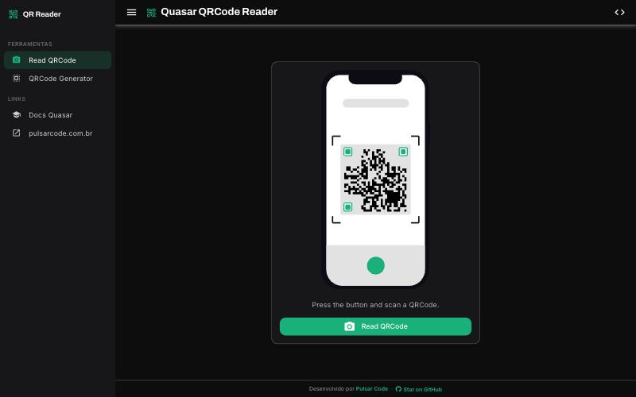
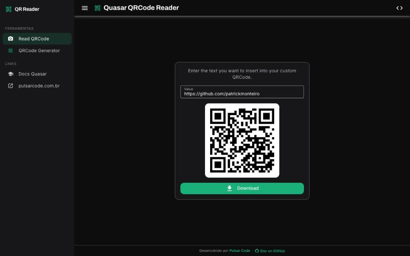

<div align="center">

# Quasar QRCode Reader

**A small, fast QR code reader & generator built with Vue 3 and Quasar 2.**
Scan QR codes straight from the camera, or generate your own and download them as PNG.

**[🔗 Live demo](https://quasar-qrcode-reader.netlify.app)**


</div>

---

## Features

- **Read QRCode** — scans QR codes live from the camera using the [Barcode Detection API](https://developer.mozilla.org/en-US/docs/Web/API/Barcode_Detection_API) (with a Wasm fallback), no server round-trip
- **QRCode Generator** — type any text/URL, preview it instantly and download it as PNG
- Responsive layout: fixed sidebar on desktop, overlay drawer on mobile
- Dark theme by design

## Screenshots

<p align="center">
  
  
</p>

## Tech stack

- [Vue 3](https://vuejs.org) (Composition API, `<script setup>`)
- [Quasar 2](https://quasar.dev) with the Vite-based CLI (`@quasar/app-vite`)
- [vue-qrcode-reader](https://github.com/gruhn/vue-qrcode-reader) for camera scanning
- [qrcode.vue](https://github.com/scopewu/qrcode.vue) for QR code generation
- ESLint (flat config) + Prettier

## Getting started

Requires Node.js `^22.12 || ^24 || >=26`.

```bash
npm install
```

### Development server

```bash
npm run dev
```

### Lint & format

```bash
npm run lint        # fixes issues
npm run lint:check  # check only
```

### Production build

```bash
npm run build
```

Configuration lives in [`quasar.config.js`](./quasar.config.js) — see the [Quasar CLI docs](https://v2.quasar.dev/quasar-cli-vite/quasar-config-file).

## Contributing

Issues and PRs are welcome.

---

<div align="center">

Built by [Pulsar Code](https://pulsarcode.com.br)

</div>
